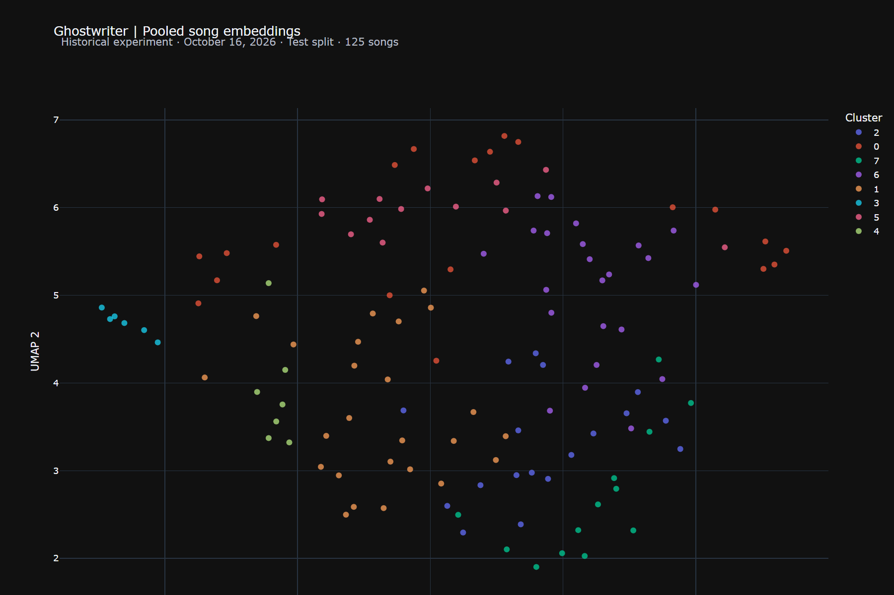
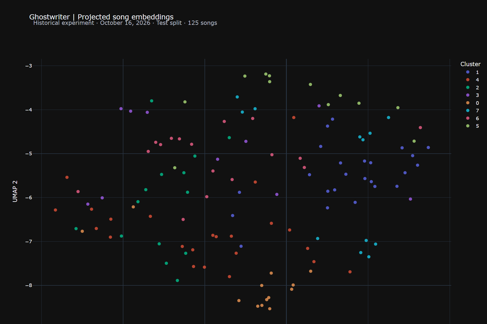
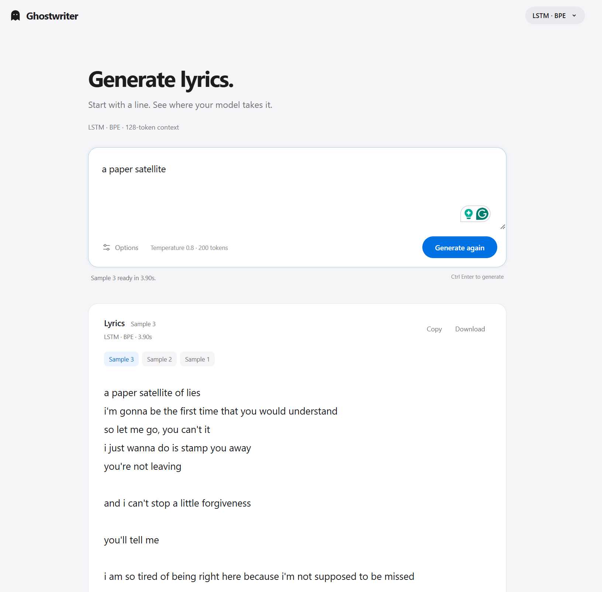

# Ghostwriter

Ghostwriter explores next-token prediction with RNNs, LSTMs, GRUs, and causal
Transformers in PyTorch. It follows text from tokenization and sequence windows
through training, evaluation, and autoregressive generation. The experiments
are shared here to make the models, results, and lessons easy to inspect.

On a 1,039-song corpus, the LSTM and Transformer reached validation perplexities
of **79.05** and **79.33** with 32-token contexts, compared with **82.37** for
the vanilla RNN. Increasing the LSTM context to 64 tokens gave **79.74**.
[Experiment results](docs/EXPERIMENTS.md) describes the setup, test scores,
and observations. [Modeling notes](docs/MODELING.md) explains the architectures
and tensor shapes.

## Setup

Use Python 3.12 and [uv](https://docs.astral.sh/uv/). From the repository root:

```sh
uv sync --locked
```

The standard environment uses CPU PyTorch on Windows and Linux, and the
standard PyTorch wheel on supported Apple Silicon Macs. GPU execution depends
on the installed PyTorch build and compatible hardware.

## Try the included examples

The ten files in [examples/lyrics](examples/lyrics/README.md) contain synthetic
demonstration text. They exercise the complete workflow; the experimental
results above describe a larger corpus.

In the commands below, replace uppercase placeholders with paths you choose.
`OUTPUT_DIRECTORY` must be a new directory outside the checkout. No example
depends on a pre-existing experiment or personal file.

```sh
uv run --locked python -m ghostwriter.pipeline --raw-dir examples/lyrics --run-dir OUTPUT_DIRECTORY --model gru --epochs 3 --batch-size 8 --min-freq 1 --device cpu
```

This prepares the text, fits a tokenizer, trains the model, and evaluates it.
The chosen output directory receives the experiment's settings, tokenizer,
checkpoint, and metrics. Existing experiment directories are not overwritten.

## Text and tokenization

Input is one UTF-8 text file per song or writing piece. Line breaks separate
lines; blank lines separate stanzas. Optional labels such as `[Verse]` and
`[Chorus]` become section tokens.

Whole songs are split approximately 80/10/10 into training, validation, and
test sets before sequence windows are created. The split seed is 42. Vocabulary
construction uses only training text. Short final windows are padded, and
padding targets do not contribute to loss or accuracy.

| Option | Representation |
| --- | --- |
| `--token-level word` | Lowercase words with separate punctuation; the default |
| `--token-level char` | Characters, including spaces and punctuation |
| `--token-level bpe` | Byte-level subwords learned from training text |
| `--no-section-tokens` | Omit section identities while retaining stanza breaks |

Beginning/end markers and newline tokens preserve song structure. Word and
character vocabularies map unseen tokens to an unknown token; byte-level BPE
can represent unseen text through its byte alphabet.

## Training

The pipeline supports four models:

| Model | Architecture |
| --- | --- |
| `rnn` | One-layer vanilla recurrent network |
| `lstm` | One-layer LSTM with hidden and cell states |
| `gru` | One-layer gated recurrent network |
| `transformer` | Two-layer causal self-attention model with learned positions |

For your own permitted text, replace `TEXT_DIRECTORY` and `OUTPUT_DIRECTORY`:

```sh
uv run --locked python -m ghostwriter.pipeline --raw-dir TEXT_DIRECTORY --run-dir OUTPUT_DIRECTORY --model lstm --seq-len 64 --stride 32 --device cpu
```

`--seq-len` is the number of input token positions; `--stride` advances the
next window. Recurrent state resets between windows. Transformer embedding
width must be divisible by four, and positional capacity must cover the context.

Training uses cross-entropy, AdamW, gradient clipping, and validation-based
checkpoint selection. Early stopping and an optional plateau scheduler respond
to validation loss. Model size, dropout, learning rate, weight decay, epochs,
and patience are configurable. `ghostwriter --help` lists the options.

Word, character, and BPE perplexities describe different prediction units.
Changing tokenization or context changes the evaluation task.

## Evaluation and generation

The evaluation and generation commands use a checkpoint and tokenizer produced
by the same experiment. Replace the placeholders with the outputs of your
training command; `PREPARED_DATA_DIRECTORY` contains its prepared splits.

```sh
uv run --locked python -m ghostwriter.training.eval --checkpoint CHECKPOINT_FILE --tokenizer TOKENIZER_FILE --data-dir PREPARED_DATA_DIRECTORY --split test --device cpu
uv run --locked python -m ghostwriter.inference.generate --checkpoint CHECKPOINT_FILE --tokenizer TOKENIZER_FILE --device cpu
```

Evaluation reports cross-entropy, perplexity, token accuracy, and target count.
It uses non-overlapping windows so each target is counted once. The loader
checks tokenizer identity and context against the model's training settings.

Generation samples a token, appends it, and feeds the latest context back into
the model. `--prompt`, `--temperature`, `--top-k`, `--max-new-tokens`, and
`--seed` control the continuation. Zero temperature selects tokens greedily.

## Contrastive song embeddings

A separate experiment freezes a trained Transformer, samples two non-overlapping
excerpts per song, mean-pools non-padding hidden states, and trains a projection
head with a same-song contrastive objective.

These commands take the output directories of experiments you have created:

```sh
uv run --locked python -m ghostwriter.training.train_contrastive --run-dir TRANSFORMER_EXPERIMENT_DIRECTORY --device cpu
uv run --locked python -m ghostwriter.training.eval_contrastive --contrastive-dir CONTRASTIVE_EXPERIMENT_DIRECTORY --split test
```

Evaluation compares pooled and projected representations using identical sampled
pairs and candidate negatives. Lower contrastive loss and better retrieval
need not imply better semantic or stylistic grouping.

K-means assigns clusters in the original embedding space; UMAP
projects the points into two dimensions. Each view is fitted independently, so
axis positions and cluster colors do not correspond between plots. These are
exploratory views, not measurements of retrieval quality.

**Pooled Transformer representations**



**Representations after the contrastive projection head**



## Generation playground

The FastAPI playground uses the same model loader and generation code as the
command-line tools. `EXPERIMENT_PARENT_DIRECTORY` is a directory containing
experiments you have created.

```sh
uv run --locked python -m ghostwriter.web --runs-dir EXPERIMENT_PARENT_DIRECTORY
```

Open `http://127.0.0.1:8000`. The interface provides model selection, prompts,
sampling settings, and reproducible generation commands. It runs one generation
at a time and keeps sample history in the browser tab's memory.



The local playground exposes model selection and sampling controls alongside
the generated continuation.

## Optional AMD GPU environment

The tracked `environments/amd/` configuration targets Windows x86-64,
Python 3.12, and AMD's `gfx1100` PyTorch build. With compatible hardware and
drivers, the PowerShell launcher runs the same pipeline:

```powershell
.\gpu.ps1 -m ghostwriter.pipeline --raw-dir TEXT_DIRECTORY --run-dir OUTPUT_DIRECTORY --model gru --device cuda
```

ROCm uses PyTorch's `cuda` device name. `HIP_VISIBLE_DEVICES` selects a device.
The CPU environment remains sufficient for the included demonstration.

## Tests

```sh
uv run --locked python -m unittest discover -s tests -v
```

Tests create synthetic text and temporary models. They cover tokenization,
sequence windows, model shapes, checkpoint loading, generation, contrastive
experiments, and playground behavior.

## Data use

Ghostwriter is intended for lyric or creative-writing data that you personally
provide and have the necessary rights or permissions to use. The bundled
examples are synthetic demonstration text. Generated text can reproduce
material from its training data.
